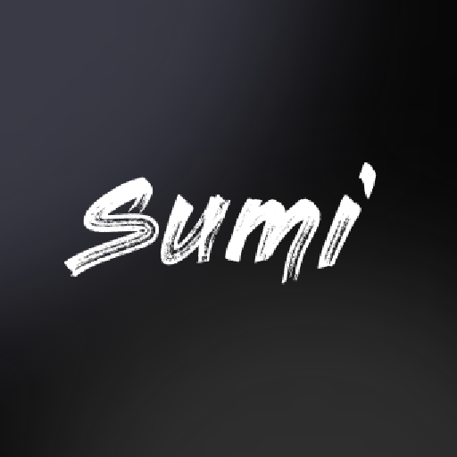
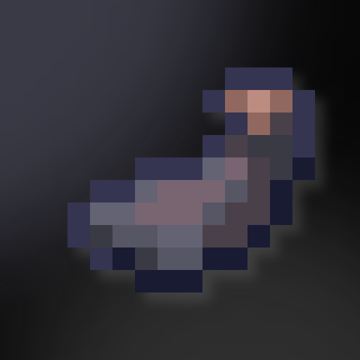

# Sumi
<center>


— One launcher. Free access. Unblock.
</center>

---

Sumi は、Shadow / Doge UB / Opium の3つのサービスへシームレスにアクセスするための、モダンなダークテーマのランチャーです。

洗練された UI、動的な URL 解決、軽量なブートストラップ構造を採用。URL リストから利用可能なエンドポイントを自動検出し、最適な接続先を選択してサービスを起動します。

## ✦ Links
メイン: [https://sumi-best.surge.sh](https://sumi-best.surge.sh)<br>
GAS(不安定): [https://script.google.com/macros/s/.../exec](https://script.google.com/macros/s/AKfycbxoNhqZFG8VijxcDpfBxs3DKs525TBersjL5mg1hTKmBxiVyOLywJK1h57DXVRapJXd/exec)

## ✦ Project Structure

ソースコードと配布ファイルを明確に分離した構成です。

```text
src/                        # Development source
├── index.html              # Bootstrap entry point
├── script.js               # Bootstrap logic
├── style.css               # Bootstrap styles
├── liquid-glass.js         # Liquid Glass UI library
└── app.html                # Main application

public/                     # Production build
├── index.html              # Optimized bootstrap
├── liquid-glass.js         # Minified UI library (independent)
├── single.html             # Self-contained single-file build
├── favicon.ico
├── favicon.png
├── img/                    # Service icons
└── obf/
    ├── index               # Base64 encoded application
    └── app                 # Base64 encoded application

link/                       # URL lists served from GitHub Raw / jsDelivr
├── shadow.txt
├── doge.txt
└── opium.txt

build.mjs                   # Build script
package.json                # Development dependencies
```

## ✦ Single-file Build

`public/single.html` は、CSS・JS（Liquid Glass 含む）・アプリ本体・画像をすべて
1 つの HTML に埋め込んだビルドです。`public/` 配下の他のファイルを参照しないため、
単体で配布・`file://` で開くこともできます。

```bash
npm run build        # 画像を Base64 で埋め込む（デフォルト・完全自己完結）
npm run build:cdn    # 画像を jsDelivr の URL で参照（軽量）
```

| モード | 目安サイズ | 特徴 |
|---|---|---|
| Base64（デフォルト） | 約 400 KB | 完全に 1 ファイルで完結。オフラインでも表示可 |
| CDN（`--cdn`） | 約 160 KB | 画像のみ jsDelivr から取得。要ネット接続 |

画像は `window.__ASSETS` というグローバル表にまとめ、アプリ側は `__ASSETS['shadow.png']`
のように参照します。そのため画像データが難読化で肥大化しません。

## ✦ Core Features

### Dynamic URL Resolution

複数のリソースからURL リストを取得します。

- 取得先: GitHub Raw / jsDelivr / Statically / esm.sh / raw.githack.com / githubraw.com
- Auto（デフォルト）は GitHub Raw を優先し、失敗時に他の取得先へ順番にフォールバック
- 設定から単一の取得先を指定することも可能
- 各 URL を iframe で順次検証
- 最初に正常に利用できた URL を自動選択

### about:blank Cloaking

about:blank を利用したクローキング機能を搭載しています。これにより、履歴に残るURLがabout:blankになります。

- 設定は LocalStorage に永続化
- 起動時のローディング開始段階で有効状態を判定
- 有効時は新しい about:blank タブへ自動的に切り替え


### Persistent Settings

ユーザー設定は LocalStorage に保存され、ブラウザを閉じた後も維持されます。

## ✦ Development

開発環境のセットアップとビルドはシンプルです。

```bash
# Install dependencies
npm install

# Build for production
npm run build
```

または直接実行：

```bash
node build.mjs
```

`src/` 内のソースを編集し、ビルドを実行するだけで `public/` 以下の配布ファイルが自動生成されます。

## ✦ Build Pipeline

本番ビルドでは Terser による JavaScript の minify と、中程度の難読化、CSS のインライン化を行います。

- Terser による minify（コメント削除・圧縮・識別子短縮）
- javascript-obfuscator による難読化
  - 文字列の65%を Base64 配列に退避（split strings / rotate / shuffle）
  - 識別子を 16 進数名に置換（グローバル名は維持）
  - 制御フロー平坦化（35%）・デッドコード挿入（10%）
  - 数値の式展開、文字列デコード用ラッパー関数
  - 自己防御・デバッグ保護は無効（安定性重視）
  - `seed` 固定で再現性のあるビルド
- Bootstrap の CSS を HTML にインライン化（JS は minify + 難読化してインライン化）
- Liquid Glass は独立した `public/liquid-glass.js` として minify + 難読化
- メインアプリケーションのインライン JS を minify + 難読化
- Base64 形式でアプリケーションを出力
- `public/` 以下に配布用ファイルを生成

---

<i>Made with ❤️ by [@zenith-kamo](https://github.com/zenith-kamo)</i>